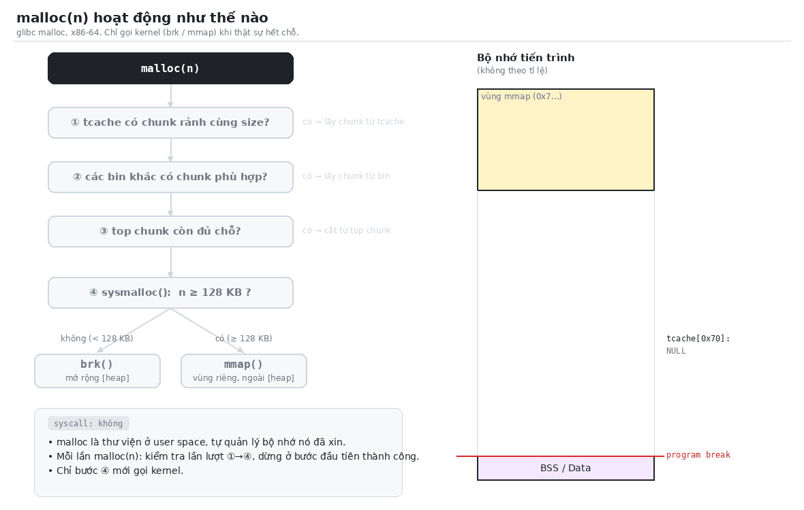

# Các khái niệm cơ bản

**A. Kernel & không gian địa chỉ**

1. Page
2. Syscall
3. Program break & vùng `[heap]`
4. Memory mapping segment (vùng mmap)
5. Anonymous / Private mapping
6. `mmap` và page
7. ASLR

**B. glibc malloc**

8. Arena (main arena)
9. Chunk
10. Top chunk & `top_pad`
11. `M_MMAP_THRESHOLD`
12. Bins
13. tcache
14. Fragmentation
15. Luồng xử lý của `malloc(n)`

**C. Other**

16. Phân biệt: page, break, top chunk, `top_pad`

## 1. Page
- Page là đơn vị nhỏ nhất mà kernel dùng để ánh xạ bộ nhớ ảo (virtual memory) sang bộ nhớ vật lý.
- Page size phụ thuộc **kiến trúc CPU**, không phụ thuộc 32-bit hay 64-bit:
    + x86 (32-bit) và x86-64 (64-bit): **4 KB = 0x1000**
    + ARM64: 4 KB / 16 KB / 64 KB tùy cấu hình kernel
    + Kiểm tra: `getconf PAGESIZE` hoặc `sysconf(_SC_PAGESIZE)`
- Với page 4 KB, 3 chữ số hex cuối của địa chỉ là **offset trong page**:
```
0x60657af672a0
  └───┬───┘└┬┘
   số page  offset trong page (0x2a0)
```
- `brk` / `sbrk` (chi tiết ở [mục 3](#3-program-break--vùng-heap)):
    + Program break có thể dịch lẻ byte, nhưng kernel luôn ánh xạ theo **cả page**
    + `malloc` luôn xin theo bội số page (vd: 0x21000) → `[heap]` trong demo tăng tròn page

```
sbrk(100):
+----------------------+ ← hết page: kernel đã ánh xạ tới đây
|  phần còn lại page   |  truy cập được, nhưng nằm ngoài break
+----------------------+ ← break mới = cũ + 100
|  100 byte            |
+----------------------+ ← break cũ
```
- `mmap` luôn cấp theo bội số page và trả về địa chỉ page-aligned (chi tiết ở [mục 6](#6-mmap-và-page))

- 32-bit vs 64-bit chỉ khác ở **kích thước trường** trong chunk:

| | 32-bit | 64-bit |
|---|---|---|
| Con trỏ, `size_t` | 4 byte | 8 byte |
| Chunk header | 8 byte | 16 byte (0x10) |
| Căn lề chunk | 8 byte | 16 byte |
| `MINSIZE` | 16 byte | 32 byte (0x20) |

## 2. Syscall
- Chương trình không tự cấp thêm bộ nhớ được, phải nhờ kernel thông qua **system call** (`brk`, `mmap`, `munmap`...)
- Syscall là cách **duy nhất** để user space yêu cầu kernel làm việc

### User mode → kernel mode → user mode
- CPU có 2 chế độ:
    + **User mode**: chương trình, libc — quyền hạn chế, không được đụng vào phần cứng hay bộ nhớ của kernel
    + **Kernel mode**: kernel — toàn quyền
- Quy trình một lần gọi syscall (vd: `brk`):
    + Step 1: Chương trình đặt tham số (số hiệu syscall, địa chỉ break mới) vào **thanh ghi** CPU
    + Step 2: Thực hiện lệnh `syscall` → CPU **chuyển sang kernel mode**
    + Step 3: Kernel xử lý: dịch break, ánh xạ thêm page
    + Step 4: Kernel **ghi kết quả vào thanh ghi**, rồi CPU **chuyển về user mode**
    + Step 5: Chương trình chạy tiếp và **đọc kết quả** từ thanh ghi
```
USER MODE                              KERNEL MODE
① đặt tham số vào thanh ghi
② lệnh syscall ──────────────────►    ③ xử lý (dịch break, ánh xạ page)
                                       ④ ghi kết quả vào thanh ghi
⑤ đọc kết quả  ◄── về user mode ──
```

- Tốc độ (ns = nanosecond = 10⁻⁹ giây):

| Thao tác | Thời gian |
|---|---|
| Gọi một hàm thường | Vài ns |
| Một syscall | Hàng trăm ns (~0,1–1 µs) |

- Syscall chậm hơn ~**100 lần** → nếu mỗi `malloc` đều gọi syscall, chương trình cấp phát hàng triệu lần sẽ chậm rõ rệt → `malloc` gọi syscall **càng ít càng tốt** (xin dư bằng `top_pad`, tái sử dụng chunk qua bins)

### Hàm libc và syscall

| Hàm | Loại | Gọi syscall khi nào? |
|---|---|---|
| `malloc`, `calloc`, `realloc` | libc | Chỉ khi hết chỗ → `brk` (< 128 KB) hoặc `mmap` (≥ 128 KB) |
| `free` | libc | bảng dưới |
| `sbrk` | libc | Gọi `brk` |
| `brk`, `mmap`, `munmap` | wrapper của syscall | **Luôn** |

#### Khi nào `free` gọi syscall?

| Trường hợp | Syscall | Ví dụ |
|---|---|---|
| Chunk cấp bằng `mmap` (cờ M = 1) | `munmap` → trả cả vùng về OS ngay | `free(big)` trong demo |
| Sau khi gộp, **top chunk > 128 KB** (`M_TRIM_THRESHOLD`) | `brk` với giá trị nhỏ hơn → thu nhỏ `[heap]` | Free chunk nằm sát đỉnh heap |
| Còn lại | **Không** — cất vào tcache / bins | `free(b)` trong demo |

Minh họa trường hợp top chunk quá lớn:

```
Trước free(C):                  Sau free(C):
+----------------+ ← break      +----------------+ ← break
| top (100 KB)   |  rảnh        |                |
+----------------+              | top mới        |  = C + top cũ
| C (50 KB)      |  đang dùng   |  (150 KB)      |    bắt đầu tại địa chỉ của C
+----------------+              +----------------+
| A              |              | A              |
```

### Quan sát
- `strace` chỉ hiện syscall (thấy `brk`, `mmap`), không hiện hàm libc (không thấy `malloc`, `free`)

```bash
strace -e trace=brk,mmap,munmap ./heap_demo
```

## 3. Program break & vùng `[heap]`
- **Program break**: địa chỉ kết thúc (đỉnh) của vùng `[heap]`, nằm ngay trên BSS
- `sbrk(0)` → lấy vị trí break; `sbrk(n)` → dịch break lên `n` byte (bên trong gọi syscall `brk`)
- `[heap]` luôn **liền mạch** và chỉ **co lại được từ đỉnh**

```
+-------------+ ← program break
|   [heap]    |  ↑ lớn dần lên
+-------------+ ← đầu heap
|     BSS     |
+-------------+
```

### `brk()` / `sbrk()`
- **brk** = program *break*; **sbrk** thường hiểu là *shift break*: dịch break đi một khoảng
- `brk` là syscall thật; `sbrk` là hàm (wrapper) của libc, bên trong gọi `brk`

| | `brk(void *addr)` | `sbrk(intptr_t increment)` |
|---|---|---|
| Tham số | Địa chỉ **tuyệt đối** cho break mới | **Khoảng dịch** so với break hiện tại |
| Trả về | `0` thành công, `-1` lỗi | Break **cũ** (= đầu vùng vừa cấp), `(void *) -1` nếu lỗi (`errno = ENOMEM`) |

- `sbrk(0)` → lấy vị trí break hiện tại (lần đầu libc gọi `brk(NULL)` để hỏi kernel)
- `sbrk(n)` → mở rộng heap `n` byte; `sbrk(-n)` → thu nhỏ `n` byte (chỉ co từ đỉnh)

```
Trước sbrk(4096):              Sau sbrk(4096):
                               +-------------+ ← break mới = cũ + 0x1000
                               | 4 KB mới    |
+-------------+ ← break cũ     +-------------+ ← giá trị sbrk trả về
|   [heap]    |                |   [heap]    |
+-------------+                +-------------+
```

- `malloc` chỉ gọi `brk` khi top chunk hết chỗ (xem [10](#10-top-chunk--top_pad) và [15](#15-luồng-xử-lý-của-mallocn))
- Không nên trộn `sbrk` với `malloc` trong code thực tế; `sbrk` đã bị loại khỏi POSIX

## 4. Memory mapping segment (vùng mmap)
- Vùng nằm giữa `[heap]` và stack, chứa thư viện `.so` và các vùng do `mmap` cấp
- Kernel tự chọn chỗ trống để đặt, thường từ trên xuống → địa chỉ dạng `0x7...`
- Mỗi vùng **độc lập**, `munmap` trả bộ nhớ về OS ngay
- "Heap" theo nghĩa rộng (bộ nhớ cấp phát động) **bao gồm cả vùng mmap**; còn `[heap]` chỉ là vùng do `brk` quản lý

| Biến trong demo | Cấp bằng | Heap (nghĩa rộng)? | Nằm trong `[heap]`? |
|---|---|---|---|
| `a`, `b`, `c` | `malloc(100)` → `brk` | ✅ | ✅ |
| `big` | `malloc(1 MB)` → `mmap` | ✅ | ❌ vùng mmap |
| `m` | `mmap()` trực tiếp | ✅ | ❌ vùng mmap |

- Chunk được `malloc` cấp bằng `mmap` vẫn là heap (có header, phải `free`), chỉ không nằm trong `[heap]`

## 5. Anonymous / Private mapping
- `MAP_ANONYMOUS`: không gắn với file nào, là RAM trống (toàn 0)
- `MAP_PRIVATE`: vùng nhớ riêng của tiến trình, **không phải shared memory**
- `MAP_SHARED` mới là vùng chia sẻ giữa các tiến trình
- `malloc` dùng `MAP_PRIVATE | MAP_ANONYMOUS`

## 6. `mmap` và page
**1. Luôn cấp theo bội số page, `length` được làm tròn lên**

Kernel quản lý bộ nhớ theo từng page, không cấp được nửa page → số byte xin được làm tròn lên số page nguyên gần nhất.

| `length` yêu cầu | Số page | Kernel thực sự cấp |
|---|---|---|
| 1 byte | 1 | `0x1000` (4096) |
| 4096 byte | 1 | `0x1000` |
| 5000 byte | 2 | `0x2000` (8192) |

<details>
<summary>Kiểm chứng: <code>mmap(5000)</code> ghi được tới byte 8191</summary>

```C
char *p = mmap(NULL, 5000, PROT_READ | PROT_WRITE, MAP_PRIVATE | MAP_ANONYMOUS, -1, 0);
p[8191] = 1;   // byte cuối của page thứ 2 → không lỗi
```

```bash
mmap(5000) = 0x7f2869360000 -> ghi p[8191] OK
```

</details>

**2. Hai trường hợp trong demo**

| | `m = mmap(1 << 20)` | `big = malloc(1 << 20)` |
|---|---|---|
| Cần | `0x100000` | `0x100000` + `0x10` (header) = `0x100010` |
| Làm tròn page | `0x100000` (= 256 page, chia hết) | `0x101000` (257 page) |
| `strace` | `mmap(NULL, 1048576, ...)` | `mmap(NULL, 1052672, ...)` |

> [!NOTE]
> Chỉ thừa 16 byte header mà malloc phải xin thêm **cả 1 page** (4 KB).

**3. Địa chỉ `mmap` trả về luôn page-aligned**

- **Page-aligned** = bắt đầu đúng tại đầu một page = chia hết cho `0x1000`
- `0x1000` = 16³ → số chia hết cho `0x1000` luôn có **3 chữ số hex cuối là `000`**
- Kernel ánh xạ nguyên page → vùng mới không thể bắt đầu giữa page

```
0x73821a4ce000     ← m: đầu page
            └┬┘
      offset trong page = 0
```

**4. Con trỏ `malloc` trả về thì không page-aligned**

`big` cũng cấp bằng mmap nhưng kết thúc bằng `010` (header chunk, xem [9. Chunk](#9-chunk)), vì **mmap trả địa chỉ cho malloc, còn malloc trả địa chỉ khác cho người dùng**:

```
mmap → malloc  ──►  0x...ff000  +---------------------------+ ← đầu vùng mmap (page-aligned)
                                | prev_size  = 0x0          |  header chunk
                                | size       = 0x101002     |  (0x10 byte)
malloc → user  ──►  0x...ff010  +---------------------------+
                                |  1 MB dữ liệu             |
                                +---------------------------+
                                |  phần dư do làm tròn page |
                    0x...100000 +---------------------------+ ← hết vùng (đầu + 0x101000)
```

- `size = 0x101002` = `0x101000` (kích thước vùng) | `0x2` (cờ **M** = `IS_MMAPPED`)
- `free(big)` → lùi 0x10 đọc header → thấy M = 1 → `munmap(big - 0x10, 0x101000)`
- `munmap` bắt buộc địa chỉ page-aligned → header giúp malloc tìm lại đúng đầu vùng

<details>
<summary>Kiểm chứng: đọc header ngay trước <code>big</code></summary>

```C
size_t *h = (size_t *)(big - 0x10);
printf("prev_size = 0x%zx, size = 0x%zx\n", h[0], h[1]);
```

```bash
big = 0x7f2869250010, prev_size = 0x0, size field = 0x101002
```

</details>

**Tóm lại**

| | `m` (mmap trực tiếp) | `big` (malloc → mmap) |
|---|---|---|
| Kích thước xin kernel | `0x100000` | `0x101000` (thêm header, làm tròn) |
| Địa chỉ đầu vùng | `0x...ce000` | `0x...ff000` |
| Địa chỉ người dùng nhận | `0x...ce000` (chính đầu vùng) | `0x...ff010` (đầu vùng + header) |
| Page-aligned? | ✅ | ❌ lệch `0x10` |
| Giải phóng | `munmap(m, 1 << 20)` | `free(big)` → malloc tự tính đầu vùng rồi `munmap` |

## 7. ASLR
- **Address Space Layout Randomization**: mỗi lần chạy, heap / mmap / stack được đặt ở địa chỉ gốc ngẫu nhiên
- Khoảng cách **bên trong** một vùng không đổi → phân tích heap bằng **offset**, không bằng địa chỉ tuyệt đối

## 8. Arena (main arena)
- Cấu trúc glibc dùng để quản lý một vùng heap: chứa top chunk, các danh sách chunk rảnh, khóa (mutex)
- **Main arena**: của thread chính, lấy bộ nhớ bằng `brk` → chính là `[heap]`
- **Thread arena**: của thread phụ, lấy bộ nhớ bằng `mmap`
- Khởi tạo **lười**: chỉ khi `malloc` lần đầu mới gọi `brk` → chương trình không `malloc` thì không tốn heap

## 9. Chunk
- Đơn vị cấp phát của `malloc` = **header 0x10** + dữ liệu người dùng
- Con trỏ `malloc` trả về = địa chỉ chunk + 0x10 → `big` kết thúc bằng `...010`
- Kích thước chunk = `(n + 8)` làm tròn lên bội số 16 → `malloc(100)` → **0x70**
    + Chỉ +8 vì trường `prev_size` của chunk kế tiếp được dùng làm chỗ chứa dữ liệu (xem Chunk structure bên dưới)

## 10. Top chunk & `top_pad`
- **Top chunk**: phần còn trống ở đỉnh arena, ngay dưới program break
- `malloc` không tìm được chunk rảnh phù hợp → **cắt từ top chunk**, không cần syscall
- Top chunk hết → mới gọi `brk` để mở rộng
- `top_pad`: mỗi lần mở rộng, malloc **xin dư thêm 128 KB (0x20000)** để giảm số lần gọi syscall
- Công thức mở rộng: size = request + top_pad + MINSIZE, rồi làm tròn lên page

```
Lần brk đầu tiên = 0x290 (tcache) + 0x20000 (top_pad) + 0x20 (MINSIZE) = 0x202b0
                 → làm tròn page = 0x21000 (132 KB)
```

- Request đầu tiên luôn là `tcache_perthread_struct` (0x290), nên dù `malloc(1)` hay `malloc(100)` thì lần đầu vẫn ra 0x21000

```bash
GLIBC_TUNABLES=glibc.malloc.top_pad=0 ./heap_demo   # tắt xin dư → brk chỉ tăng 0x1000
```

## 11. `M_MMAP_THRESHOLD`
- Ngưỡng để `malloc` chọn giữa `brk` và `mmap`, mặc định **128 KB**
    + `< 128 KB` → cắt từ arena (`brk`)
    + `>= 128 KB` → `mmap` riêng, chunk có cờ **M = 1**, `free` sẽ gọi `munmap`
- `malloc(1 MB)` cần 1 MB + 0x10 header → làm tròn page → `mmap(0x101000)`
- Ngưỡng **thay đổi động**: sau khi `free` một chunk mmap, ngưỡng tăng lên bằng kích thước chunk đó

## 12. Bins
- **Bin** = danh sách liên kết chứa các chunk đã `free`, phân loại theo kích thước
- `free()` thường **không** trả bộ nhớ về kernel, mà cất chunk vào bin để lần `malloc()` sau dùng lại
- Nhiều loại bin vì phải cân bằng 2 mục tiêu: **nhanh** (không xử lý thêm) và **ít phân mảnh** (gộp chunk liền kề)

| Bin | Kích thước chunk | Số bin | Liên kết | Đặc điểm |
|---|---|---|---|---|
| **tcache** | 0x20 → 0x410 | 64 | Đơn, LIFO | Riêng mỗi thread, tối đa **7 chunk/bin**, nhanh nhất |
| **fastbin** | 0x20 → 0x80 | 7 | Đơn, LIFO | **Không gộp** chunk liền kề; dùng khi tcache cùng cỡ đã đầy |
| **unsorted bin** | Mọi cỡ | 1 | Đôi | "Phòng chờ": chunk vừa free (đã gộp) vào đây trước |
| **smallbin** | < 0x400 | 62 | Đôi, FIFO | Mỗi bin đúng **một** kích thước |
| **largebin** | ≥ 0x400 | 63 | Đôi, sắp theo cỡ | Mỗi bin chứa một **khoảng** kích thước |

- Liên hệ với `struct malloc_chunk`:
    + `fd` / `bk`: con trỏ liên kết chunk trong bin (bin liên kết đơn chỉ dùng `fd`)
    + `fd_nextsize` / `bk_nextsize`: **chỉ dùng trong largebin**, để nhảy nhanh giữa các kích thước

Khi `free(p)`, chunk đi đâu:

```
free(p)
  ├─ chunk cấp bằng mmap (cờ M=1)?  → munmap, trả kernel ngay
  ├─ tcache cùng cỡ chưa đủ 7?       → vào tcache
  ├─ chunk ≤ 0x80?                    → vào fastbin (không gộp)
  └─ còn lại → gộp với chunk rảnh liền trước/sau
        ├─ sát top chunk? → nhập vào top chunk
        └─ không          → vào unsorted bin
```

Ví dụ: `free` 9 chunk cùng cỡ 0x70

```C
void *p[9];
for (int i = 0; i < 9; i++) p[i] = malloc(100);
for (int i = 0; i < 9; i++) free(p[i]);
```

```
tcache[0x70]  : p6 → p5 → p4 → p3 → p2 → p1 → p0    (đủ 7 → đầy)
fastbin[0x70] : p8 → p7                             (phần dư sang fastbin)
```

- Xem bins trong gdb (plugin pwndbg): lệnh `bins`

## 13. tcache
- Loại bin nhanh nhất, được kiểm tra đầu tiên khi `malloc` (xem [12. Bins](#12-bins))
- Bộ đệm chunk đã `free` của **mỗi thread** (glibc >= 2.26), giúp `malloc` lấy lại chunk nhanh mà không cần khóa arena
- Được mô tả bởi `tcache_perthread_struct`, cấp bằng chính `malloc` ở **lần gọi đầu tiên** → luôn nằm ở đầu heap

```C
typedef struct tcache_perthread_struct {
    uint16_t      counts[64];   // 64 × 2 = 0x80  : số chunk trong mỗi bin
    tcache_entry *entries[64];  // 64 × 8 = 0x200 : con trỏ tới chunk rảnh đầu tiên
} tcache_perthread_struct;      // 0x280 + 0x10 header = chunk 0x290
```

- `free(b)` → B vào bin 0x70 của tcache; `malloc(100)` tiếp theo sẽ lấy lại đúng B

## 14. Fragmentation
- Có bộ nhớ rảnh nhưng nằm rời rạc, không dùng được hoặc không trả về OS được

```
[ A dùng ][ B rảnh ][ C dùng ][ top chunk ]
             ↑ không trả OS được vì break chỉ co từ đỉnh, mà C còn đang dùng
```

- Đây là nhược điểm chính của `brk`, và là lý do chunk lớn được cấp bằng `mmap`

## 15. Luồng xử lý của `malloc(n)`
- `malloc` là thư viện ở user space, **tự quản lý** bộ nhớ nó đã xin
- Chỉ khi **hết chỗ** mới gọi kernel (`brk` hoặc `mmap`), và mỗi lần xin đều xin dư

```
malloc(n)
   │
   ├─ ① tcache có chunk rảnh cùng size?   → trả về        (không syscall)
   ├─ ② các bin khác có chunk phù hợp?    → trả về        (không syscall)
   │      fastbin → smallbin → unsorted bin → largebin
   ├─ ③ top chunk còn đủ chỗ?             → cắt, trả về   (không syscall)
   └─ ④ hết chỗ → sysmalloc():
          ├─ n >= 128 KB → mmap()  : vùng riêng, ngoài [heap]
          └─ n <  128 KB → brk()   : mở rộng [heap]
                   (xin: chunk + top_pad 128 KB, làm tròn page)
                        ↓
                 kernel dịch break, ánh xạ thêm page
                        ↓
                 top chunk lớn lên → cắt chunk → trả về
```

<!-- <p align="center">
    
</p> -->
<p align="center">
    <video src="../assets/malloc_flow.mp4" width="800" controls></video>
</p>

| Lời gọi | Dừng ở | syscall |
|---|---|---|
| `a = malloc(100)` (lần đầu) | ④ → `brk()`: heap +0x21000, tạo tcache + chunk A | `brk` |
| `b = malloc(100)` | ③ cắt từ top chunk | không |
| `free(b)` | B vào `tcache[0x70]` | không |
| `c = malloc(100)` | ① lấy lại B từ tcache (`c == b`) | không |
| `big = malloc(1 << 20)` | ④ → `mmap()`: vùng riêng, break không đổi | `mmap` |

- Hiểu **sai**: `malloc(n)` → gọi OS → `brk()` → cấp phát
- Hiểu **đúng**: `malloc(n)` → tìm trong bộ nhớ đã có trước → chỉ gọi `brk()`/`mmap()` khi hết chỗ
- Chỉ **bộ nhớ động** đi qua `malloc`; biến local (stack) và biến global (Data/BSS) không liên quan


## 16. Phân biệt: page, break, top chunk, `top_pad`

### 16.1. Khái niệm

| Khái niệm | Là gì | Ai quản lý |
|---|---|---|
| **Page** | Đơn vị cấp/thu bộ nhớ (4 KB) | Kernel |
| **Program break** | Địa chỉ cuối `[heap]` | Kernel |
| **Top chunk** | Vùng rảnh ở đỉnh heap | malloc |
| **`top_pad`** | Con số 128 KB: xin dư / giữ lại | malloc |

```
+------------------+ ← break (= cuối top chunk)
|  top chunk       |
+------------------+
|  các chunk khác  |
+------------------+ ← heap_base
```

### 16.2. Gộp vào top
- Chunk free nằm **sát** top → nhập vào top
- Không áp dụng cho chunk vào tcache/fastbin (≤ 0x410)

### 16.3. Trim (thu nhỏ heap)

**Điều kiện** (cả 2):
1. Chunk vừa free (sau gộp) ≥ **64 KB**
2. Top chunk ≥ **128 KB**

**Cách trả:**
- Giữ lại ≈ `top_pad`, trả phần **dư**, làm tròn **xuống** page
- Dư < 1 page → không trả gì
- Chỉ cắt ở **đỉnh**, chunk giữa heap không được trả

**Case 1: chunk sát top** → sau gộp = top (cùng 1 giá trị)

```
| top 100 KB |    free(C)    | top 150 KB |
| C    50 KB |      →        |            |
```

- 150 KB ≥ 64 ✅, ≥ 128 ✅ → trim
- Dư 22 KB → trả **20 KB**

**Case 2: chunk không sát top** → sau gộp ≠ top

```
| top 131 KB |  ← xét ≥ 128 KB
| A (dùng)   |  ← chắn giữa
| D  70 KB   |  ← free(D), xét ≥ 64 KB
```

- 70 KB ≥ 64 ✅, 131 KB ≥ 128 ✅ → trim chạy
- Dư 3 KB < 1 page → **không trả gì**; D vẫn kẹt giữa heap

### 16.4. Tổng hợp

| Hành động | Break | Top chunk |
|---|---|---|
| `malloc` nhỏ, top đủ | Đứng yên | Nhỏ lại |
| `malloc` nhỏ, top thiếu | **Lên** | Bù lại ≈ `top_pad` |
| `free` sát top, top ≥ 128 KB | **Xuống** (nếu dư ≥ 1 page) | Giữ ≈ `top_pad` |
| `free` chunk nhỏ | Đứng yên | Không đổi |
| `malloc` ≥ 128 KB | Đứng yên | Không đổi (`mmap`) |