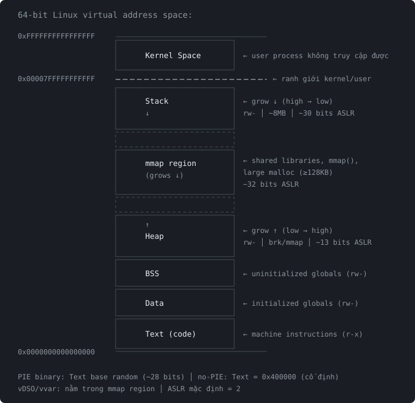

# Memory Layout of a Process

Khi chạy một program, OS tạo một process với không gian bộ nhớ riêng (virtual address space). Mỗi process có layout riêng, không truy cập được memory của process khác.

## Tổng quan




## Từng vùng chi tiết

### Text (.text)
- Chứa machine code (instructions)
- Permission: `r-x`
- Cố định sau khi load, không thay đổi
- PIE binary: base address random mỗi lần chạy, nhưng offset bên trong cố định

```C
#include <stdio.h>

int main() {
    printf("Hello, World!");
    return 0;
}
```
```bash
> gcc example.c -o example -m32
> objdump -d -M intel example
...
# Text section of main function
0000118d <main>:
    118d:       8d 4c 24 04             lea    ecx,[esp+0x4]
    1191:       83 e4 f0                and    esp,0xfffffff0
    1194:       ff 71 fc                push   DWORD PTR [ecx-0x4]
    1197:       55                      push   ebp
    1198:       89 e5                   mov    ebp,esp
    119a:       53                      push   ebx
    119b:       51                      push   ecx
    119c:       e8 28 00 00 00          call   11c9 <__x86.get_pc_thunk.ax>
    11a1:       05 37 2e 00 00          add    eax,0x2e37
    11a6:       83 ec 0c                sub    esp,0xc
    11a9:       8d 90 30 e0 ff ff       lea    edx,[eax-0x1fd0]
    11af:       52                      push   edx
    11b0:       89 c3                   mov    ebx,eax
    11b2:       e8 89 fe ff ff          call   1040 <printf@plt>
    11b7:       83 c4 10                add    esp,0x10
    11ba:       b8 00 00 00 00          mov    eax,0x0
    11bf:       8d 65 f8                lea    esp,[ebp-0x8]
    11c2:       59                      pop    ecx
    11c3:       5b                      pop    ebx
    11c4:       5d                      pop    ebp
    11c5:       8d 61 fc                lea    esp,[ecx-0x4]
    11c8:       c3                      ret
...
```

### Data (.data)
- Chứa biến toàn cục và static đã khởi tạo
- Permission: `rw-` (read + write)

```C
int global_var = 42;            // .data
static int static_var = 100;    // .data
const char *ptr = "hello";      // ptr trong .data, "hello" trong .rodata
```

### BSS (.bss)
- Chứa biến toàn cục và static chưa khởi tạo (hoặc = 0)
- Permission: `rw-`
- Không chiếm space trong file ELF (chỉ lưu size)
- OS zero-fill khi load vào memory

```C
int uninitialized;          // .bss (= 0 khi chạy)
char *str;                  // .bss
short arr[12];              // .bss
static char buffer[4096];   // .bss
int zero_var = 0;           // .bss (tối ưu: = 0 nên không cần lưu trong file)
```

### Heap
- Cấp phát dynamic bằng `malloc()`, `calloc()`, `realloc()`
- Grows từ low → high address
- Quản lý bởi glibc allocator (ptmalloc2)
- Chunk nhỏ (< 128KB): dùng `brk()`, nằm trong vùng `[heap]`
- Chunk lớn (≥ 128KB): dùng `mmap()`, nằm trong vùng mmap

```C
void *a = malloc(100);     // heap (brk)
void *b = malloc(200000);  // mmap region (> 128KB)
free(a);                   // trả về free list, OS chưa thu hồi
free(b);                   // munmap, trả về OS ngay
```

Chi tiết hơn xem: `heap_concepts.md`

### mmap Region
- Nằm giữa heap và stack
- Grows từ high → low (ngược với heap)
- Chứa:
    + **Shared libraries**: libc.so.6, ld-linux.so, libpthread.so, ...
    + **Large malloc**: chunk ≥ 128KB được `mmap()` ở đây
    + **File mapping**: `mmap()` map file vào memory
    + **Anonymous mapping**: `mmap(MAP_ANONYMOUS)` — memory không gắn với file
    + **vDSO/vvar**: (xem bên dưới)

```bash
# Xem mmap region trong /proc/self/maps
> cat /proc/self/maps
...
7f8b12c00000-7f8b12c28000 r--p  /lib/x86_64-linux-gnu/libc.so.6    ← libc (read-only)
7f8b12c28000-7f8b12dbd000 r-xp  /lib/x86_64-linux-gnu/libc.so.6    ← libc (code)
7f8b12dbd000-7f8b12e15000 r--p  /lib/x86_64-linux-gnu/libc.so.6    ← libc (read-only data)
7f8b12e15000-7f8b12e19000 rw-p  /lib/x86_64-linux-gnu/libc.so.6    ← libc (writable data, GOT)
7f8b12e19000-7f8b12e26000 rw-p  (anonymous)                         ← anonymous mapping
...
7f8b12fc3000-7f8b12fc5000 rw-p  /lib64/ld-linux-x86-64.so.2        ← dynamic linker
...
```

### Stack
- Chứa local variables, function arguments, return addresses, saved registers
- Grows từ high → low address
- Permission: `rw-` (NX enabled) hoặc `rwx` (NX disabled)
- Size giới hạn (thường 8MB mặc định)

```bash
> ulimit -s
8192    # 8MB stack limit
```

```C
// 32-bit (cdecl): arguments truyền qua stack
void func_32(int arg1) {
    char buffer[256];        // stack
    int local_var = 10;      // stack
    // stack frame: buffer | local_var | saved ebp | return addr | arg1
}
 
// 64-bit (System V AMD64): 6 args đầu qua register (rdi, rsi, rdx, rcx, r8, r9)
// chỉ arg thứ 7+ mới lên stack
void func_64(int arg1) {    // arg1 trong rdi, KHÔNG trên stack
    char buffer[256];        // stack
    int local_var = 10;      // stack
    // stack frame: buffer | local_var | saved rbp | return addr
    // (không có arg1 trên stack vì truyền qua register)
}
```

### Kernel Space
- Nửa trên của virtual address space
- User process KHÔNG truy cập được (SIGSEGV nếu cố)
- Chứa kernel code, kernel data, page tables
- Ranh giới: 
    + 32-bit: `0xC0000000` (3GB user / 1GB kernel)
    + 64-bit: `0x00007FFFFFFFFFFF` (canonical address boundary)

```C
// Cố truy cập kernel space → crash
int *p = (int *)0xFFFFFFFF80000000;
*p = 42;  // SIGSEGV
```


## vDSO và vsyscall

### vDSO (virtual Dynamic Shared Object)
- Shared library đặc biệt do **kernel inject** vào mỗi process
- Chứa một số syscall thường dùng mà không cần context switch vào kernel mode
- Nhanh hơn syscall thông thường ~100x

```bash
> cat /proc/self/maps | grep vdso
7ffd1cbfe000-7ffd1cc00000 r-xp [vdso]

> ldd /bin/ls
        linux-vdso.so.1 (0x00007ffcf87fe000)   ← vDSO
        libc.so.6 => /lib/x86_64-linux-gnu/libc.so.6
        /lib64/ld-linux-x86-64.so.2
```

- Syscalls trong vDSO:
    + `gettimeofday()` — lấy thời gian hiện tại
    + `clock_gettime()` — high-resolution timer
    + `getcpu()` — CPU hiện tại
- Dữ liệu được kernel update trong vùng `[vvar]` (read-only cho user)

```bash
> cat /proc/self/maps | grep vvar
7ffd1cbfc000-7ffd1cbfe000 r--p [vvar]   ← kernel data cho vDSO (read-only)
```

### vsyscall (legacy)
- Tiền thân của vDSO, fixed address `0xffffffffff600000`
- Không an toàn (cố định → dễ exploit)
- Hầu hết modern kernel đã disable hoặc emulate

```bash
> cat /proc/self/maps | grep vsyscall
ffffffffff600000-ffffffffff601000 --xp [vsyscall]    # có thể không xuất hiện nếu đã disable
```


## `/proc/self/maps` — Đọc memory layout

```bash
> cat /proc/self/maps
# Format mỗi dòng:
# start-end  permissions  offset  dev  inode  pathname

# ═══ Binary ═══
555555554000-555555555000 r--p 00000000 08:01 1234  /home/user/hello    ← ELF header
555555555000-555555556000 r-xp 00001000 08:01 1234  /home/user/hello    ← .text (code)
555555556000-555555557000 r--p 00002000 08:01 1234  /home/user/hello    ← .rodata
555555557000-555555558000 r--p 00002000 08:01 1234  /home/user/hello    ← .got (Full RELRO)
555555558000-555555559000 rw-p 00003000 08:01 1234  /home/user/hello    ← .data, .bss, .got.plt

# ═══ Heap ═══
555555559000-55555557a000 rw-p 00000000 00:00 0     [heap]

# ═══ mmap region (shared libraries) ═══
7ffff7c00000-7ffff7c28000 r--p 00000000 08:01 5678  /lib/.../libc.so.6
7ffff7c28000-7ffff7dbd000 r-xp 00028000 08:01 5678  /lib/.../libc.so.6  ← libc code
7ffff7dbd000-7ffff7e15000 r--p 001bd000 08:01 5678  /lib/.../libc.so.6
7ffff7e15000-7ffff7e19000 rw-p 00214000 08:01 5678  /lib/.../libc.so.6

7ffff7fc1000-7ffff7fc3000 r--p 00000000 00:00 0     [vvar]
7ffff7fc3000-7ffff7fc5000 r-xp 00000000 00:00 0     [vdso]
7ffff7fc5000-7ffff7fc6000 r--p 00000000 08:01 9012  /lib64/ld-linux-x86-64.so.2
7ffff7fc6000-7ffff7ff1000 r-xp 00001000 08:01 9012  /lib64/ld-linux-x86-64.so.2
...

# ═══ Stack ═══
7ffffffde000-7ffffffff000 rw-p 00000000 00:00 0     [stack]
```

### Cách đọc permissions
| Ký tự | Ý nghĩa | Ghi chú |
|-------|---------|---------|
| `r` | Read | |
| `w` | Write | |
| `x` | Execute | |
| `p` | Private | Copy-on-write: ghi vào không ảnh hưởng file gốc |
| `s` | Shared | Ghi vào ảnh hưởng file gốc (dùng cho shared memory) |

### Dùng trong exploit
```bash
# Tìm vùng có quyền execute (đặt shellcode, ROP gadget)
> cat /proc/self/maps | grep 'r-xp'

# Tìm vùng rwx (hiếm, chỉ khi NX disabled)
> cat /proc/self/maps | grep 'rwxp'

# Tìm libc base address (cho ret2libc)
> cat /proc/self/maps | grep 'libc' | head -1
7ffff7c00000-7ffff7c28000 r--p ... /lib/.../libc.so.6
# libc base = 0x7ffff7c00000
```


## ASLR ảnh hưởng đến từng vùng

```
Vùng nhớ         ASLR=0 (off)               ASLR=2 (on, default)
─────────────    ────────────────────        ──────────────────────
Text (no-pie)    0x400000 (cố định)          0x400000 (CỐ ĐỊNH)
Text (pie)       0x555555554000 (cố định)    Random mỗi lần chạy
Heap             Cố định                     Random (ASLR ≥ 2)
mmap/libc        Cố định                     Random mỗi lần chạy
Stack            Cố định                     Random mỗi lần chạy
vDSO             Cố định                     Random mỗi lần chạy
```

> **Note**: Trên 32-bit, no-PIE base = `0x08048000`, PIE base = `0x56555000`

```bash
# ASLR off: chạy 2 lần, stack address giống nhau
> echo 0 | sudo tee /proc/sys/kernel/randomize_va_space
> cat /proc/self/maps | grep stack
7ffffffde000-7ffffffff000 rw-p 00000000 00:00 0  [stack]
> cat /proc/self/maps | grep stack
7ffffffde000-7ffffffff000 rw-p 00000000 00:00 0  [stack]    ← giống

# ASLR on: chạy 2 lần, stack address khác nhau
> echo 2 | sudo tee /proc/sys/kernel/randomize_va_space
> cat /proc/self/maps | grep stack
7ffd2c5f0000-7ffd2c611000 rw-p 00000000 00:00 0  [stack]
> cat /proc/self/maps | grep stack
7ffee38d1000-7ffee38f2000 rw-p 00000000 00:00 0  [stack]    ← khác
```

### Entropy theo vùng (64-bit)

| Vùng | Entropy bits | Số vị trí có thể |
|------|-------------|-------------------|
| Stack | ~30 bits | ~1 tỉ |
| mmap/libc | ~32 bits (mmap_rnd_bits) | ~4 tỉ |
| Heap | ~13 bits | ~8192 |
| PIE binary | ~28 bits | ~268 triệu |

```bash
> sudo cat /proc/sys/vm/mmap_rnd_bits
32      # 64-bit process: 32 bits entropy cho mmap
> sudo cat /proc/sys/vm/mmap_rnd_compat_bits
8       # 32-bit process trên 64-bit kernel: chỉ 8 bits
```


## Liên kết giữa ELF Segments và Memory Layout
 
```
ELF file (on disk)                      Process memory (runtime)
                                        ┌───────────────────────┐ High addr
                                        │ [stack]               │ rw-
                                        ├───────────────────────┤
                                        │ [vdso]                │ r-x
                                        │ [vvar]                │ r--
                                        │ ld-linux.so           │
                                        │ libc.so.6             │ r-x/rw-
                                        │   (mmap region)       │
                                        ├───────────────────────┤
                                        │ [heap]                │ rw-
┌─────────────────┐                     ├───────────────────────┤
│ ELF Header      │                     │                       │
│ Program Headers │                     │                       │
├─────────────────┤                     │                       │
│ .data           │ ─── LOAD rw- ──>    │ .data, .bss, .got.plt │ rw-
│ .bss            │                     ├───────────────────────┤
├─────────────────┤                     │ .rodata               │ r--
│ .rodata         │ ─── LOAD r-- ──>    ├───────────────────────┤
├─────────────────┤                     │ .text, .plt           │ r-x
│ .text           │ ─── LOAD r-x ──>    │                       │
│ .plt            │                     └───────────────────────┘ Low addr
├─────────────────┤
│ .got            │
│ .dynamic        │
├─────────────────┤
│ .symtab         │ ✗ (không load vào memory)
│ .strtab         │ ✗
│ .debug_*        │ ✗
└─────────────────┘
 
Thứ tự address (low → high):
  .text → .rodata → .data/.bss → [heap] → ... → mmap (libc) → ... → [stack]
```
 
### Exploit liên quan từng vùng
 
| Vùng | Exploit technique |
|------|-------------------|
| Stack | Buffer/stack overflow, shellcode (NX off), ROP (NX on) |
| Heap | Heap overflow, UAF, double free, tcache poisoning |
| .got.plt | GOT overwrite (format string %n, heap overflow) |
| libc | ret2libc, one-gadget, ret2csu |
| .text | ROP gadgets, partial overwrite (PIE) |