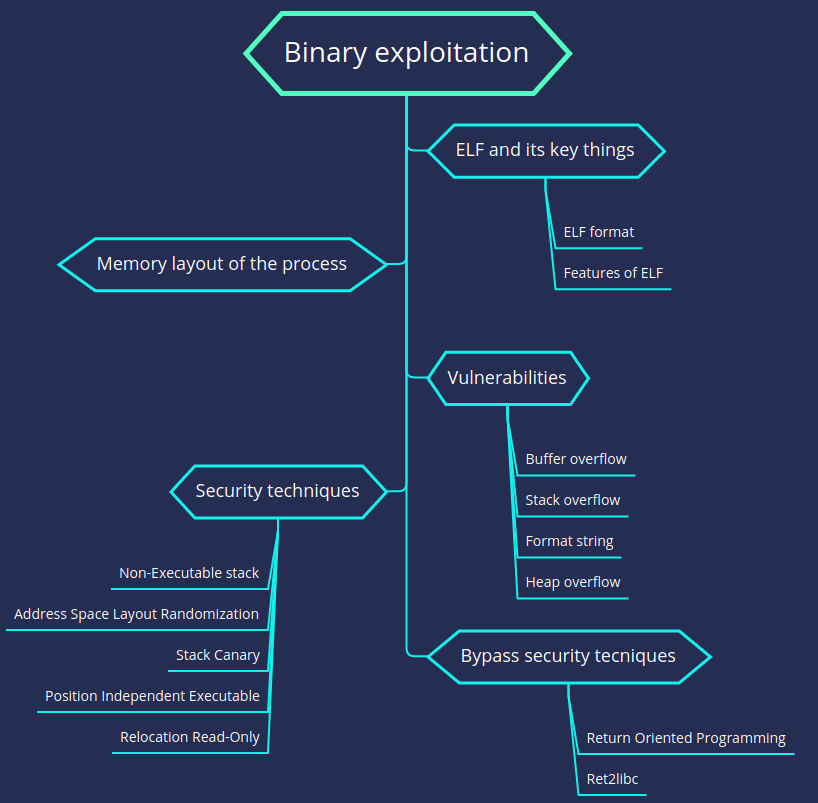

# Binary Exploitation
 

  

## References

Thanks to these resource for help me learn basic pwn as well:
- [basic-of-pwn](https://github.com/whatsyourask/basics-of-pwn)
- [JHT Pwner playlist](https://www.youtube.com/playlist?list=PLEvZsp0uc3SFuVi6TtcahxqsEbV29lXAM)
- [pwn.college](https://pwn.college)
- [overthewire](https://overthewire.org)
- [pwnable](https://pwnable.kr/play.php)
- [kerkroups's blogs](https://medium.com/@kerkroups)
- [how2heap](https://github.com/shellphish/how2heap)
- [ret2 wargames](https://wargames.ret2.systems)
- [ir0nstone](https://ir0nstone.gitbook.io)